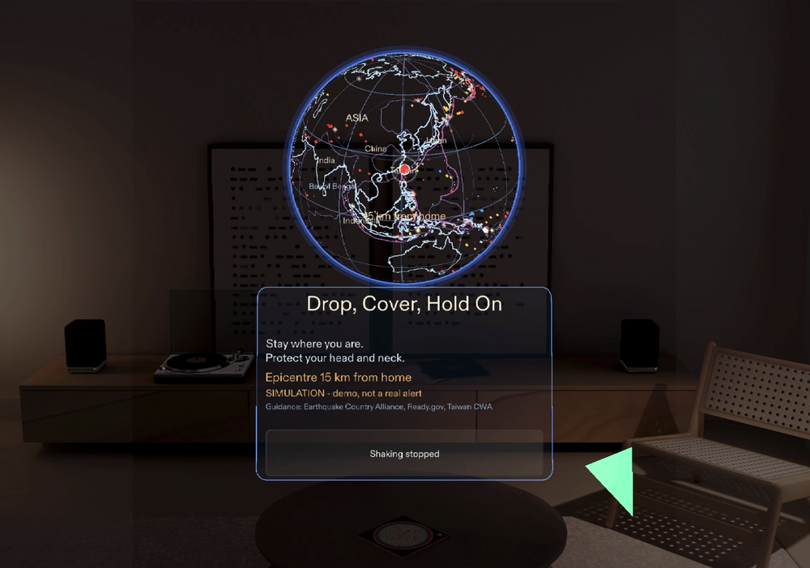
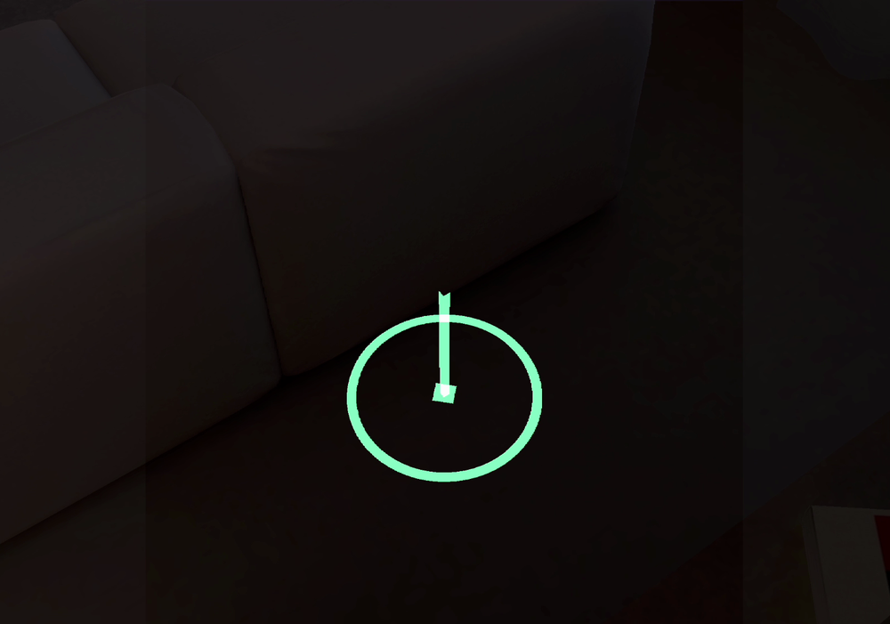
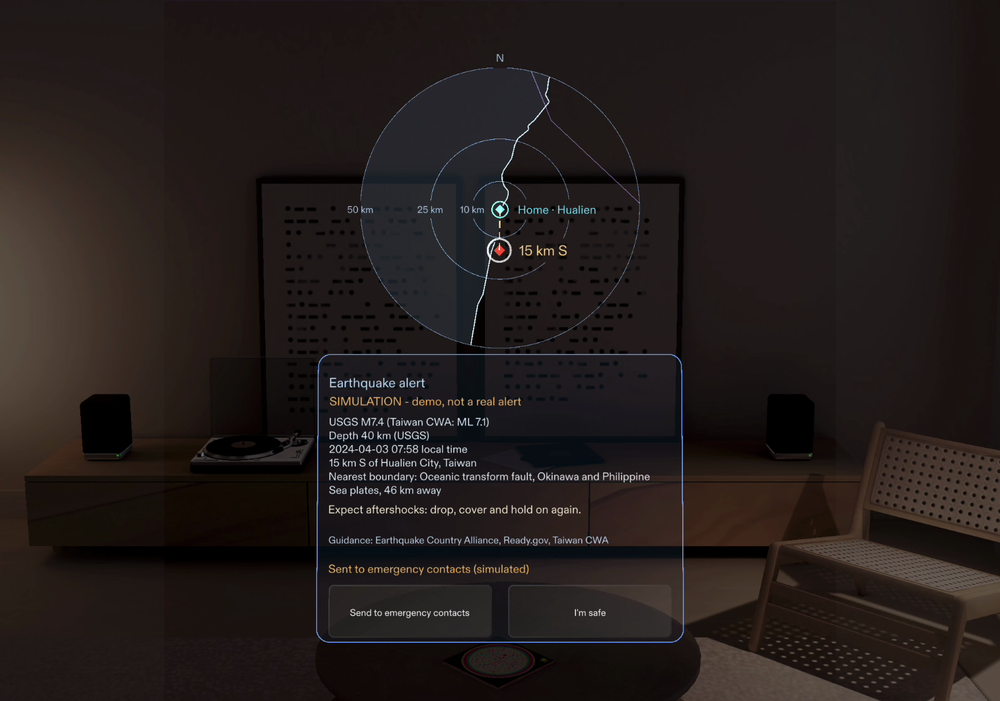
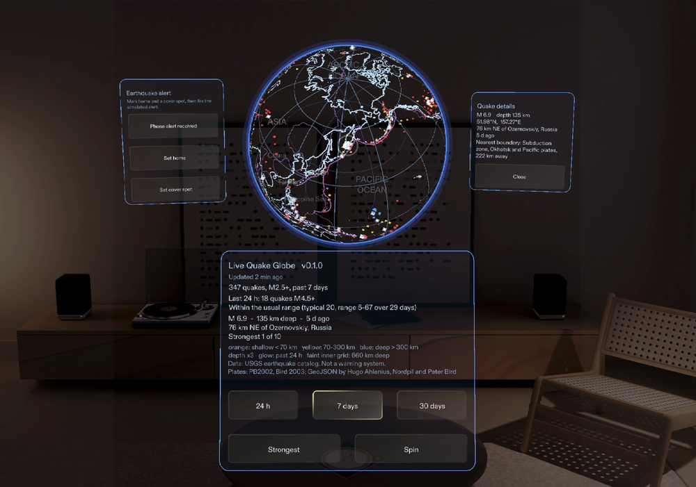

# Live Quake Globe

When the earthquake alert hits your phone, this Lens for Snap Spectacles (SPECS) puts it in your
room, with nothing to hold. Drop, Cover, Hold On comes first, and your cover spot is marked beside
you. Once the quake's location is known, the live globe in front of you zooms into a map of your
area: where it struck, and how far that is from home. After the shaking it shows what happened and
which plates met, and one pinch tells your emergency contacts.

Made for the Learn AR with SPECS hackathon:
- planned with Snap's plan-lens skill pack;
- built by Claude Code through Snap's CLAD plugin and the Lens Studio MCP;
- tested with LEAF.

> **A simulation, not a warning system.** The alert here is a stand-in: a button replays the M7.4
> Hualien, Taiwan earthquake of 2024-04-03 from the USGS catalog. The Lens doesn't detect earthquakes
> or send messages. It has run in the Lens Studio preview only, not yet on Spectacles. See
> [docs/SAFETY.md](docs/SAFETY.md).

**In the Lens Studio preview (SPECS 27):**

| The alert: Drop, Cover, Hold On first, under a map of your area | Your cover spot, on the floor | After the shaking: the details | Around it: the live globe |
|---|---|---|---|
|  |  |  |  |

## What it does

**The alert moment (a simulation)**

1. Before an alert, pinch **Set cover spot**. Look where you would take cover, and pinch: under a
   sturdy table, as official guidance says first, or by an inside wall away from windows. A
   world-query hit test places the spot on that surface.
2. Pinch **Phone alert received**, the stand-in for a real phone alert. A chime plays.
   - The card leads with Drop, Cover, Hold On and "Stay where you are".
   - The dashboard steps aside. The only button left is **Shaking stopped**.
3. The globe turns to the epicentre and zooms into a map of your area. On a 24 cm globe, 15 km is
   less than 0.3 mm, so the map takes its place: home at the centre, distance rings, and the
   epicentre at its true direction and distance ("15 km S"), joined to home by a warm dashed line,
   with the land faintly tinted, the coastline, nearby place names and plate boundaries. Every
   distance from home on it is true. Quakes elsewhere fade out.
4. If your cover spot is out of view, a small arrow at the edge of your view and a chime point to it.
5. After you pinch **Shaking stopped**, the card shows:
   - USGS M7.4 (Taiwan CWA: ML 7.1)
   - the depth, the local time and the place
   - the nearest plate boundary
6. Then pinch **Send to emergency contacts** (simulated), and **I'm safe**: the map zooms back out
   to the globe.

**The live globe**

- **Every quake from the USGS real-time feeds, at its true location and depth.** Depth is drawn
  three times deeper than true scale, so slabs show on a 24 cm globe; the legend always says so.
- **Map detail:**
  - the 1:50m coastline, with island arcs;
  - PB2002 plate boundaries, with barbs on subduction zones;
  - continent, ocean and country names that never overlap.
- **Three windows:** 24 hours (M2.5+), 7 days (M2.5+), 30 days (M4.5+).
- **Strongest:** tours the ten largest events. The globe turns each one toward you and shows its
  magnitude, depth, time, place and the nearest plate boundary.
- **Is today normal?** Compares the last 24 hours of M4.5+ quakes with the previous 29 days, using
  plain counts. No forecasting.
- **Honest about its data:**
  - shows how old the picture is;
  - says when it is offline or stale;
  - never drops records silently;
  - keeps the last good data when a refresh fails.
- **Made for a see-through display:**
  - everything is light on dark, because dark pixels are transparent on the glasses;
  - the panel and buttons are Snap's free Spectacles UI Kit.

## How it was planned and built

- **Planned** with the plan-lens skill pack. The brief is
  [lens/devpost/design-brief.md](lens/devpost/design-brief.md). The learner answered the interview
  in Chinese; the brief is its English write-up. It now also holds the design notes added after
  each review. The first notes came from an AI-assisted review that the learner
  approved.
- **Built** by Claude Code with Snap's CLAD plugin, in headless passes that drive Lens Studio
  through its MCP server:
  - the alert overlay;
  - LEAF fixes;
  - map detail;
  - the two-stage alert;
  - readability and a cover spot placed on real surfaces;
  - the off-view arrow;
  - the changes from the video review;
  - the arrow's shape and the epicentre label, after a full-size check of the second cut;
  - the committee's second review: map names step aside from the epicentre ring, the quake-details
    test pinches a quake on the globe, and the cover-spot hint and the guidance line read better;
  - the map of your area, asked for by the learner after watching the video: during the alert the
    globe zooms into a map around home (finished after a Lens Studio restart);
  - the map's land tint and a warm dashed line from home to the epicentre, after an AI-assisted
    check of the first recording with the map;
  - the two demo-video drivers, the LEAF scenarios `demo_alert` and `demo_globe`, written fresh
    from a shot list;
  - the review of the narrated cut: the zoom never hides the alert card's or the dashboard's
    text, map labels keep clear of lines, and the coastline gives way to the dashed line
    (finished after a usage limit);
  - the review of the final cut: each ring label sits on its own ring, all along one direction
    from home, and the cover-spot hint keeps clear of the globe and the dashboard while the view
    sweeps down to the floor.

  Each pass's prompt and report are in [docs/clad-build/](docs/clad-build/).
- **Tested** with LEAF: one scenario for each done criterion, plus the home marker. They run in the
  preview. At DEBUG level LEAF also checks that a ray from the viewer reaches every button it
  presses.
- **Not built through CLAD:**
  - the first prototype, the live globe of 2026-10-19;
  - the shared `core/`, `data/` and `tools/`;
  - the alert chime's sound file, generated by `tools/make_chime.py` (CLAD wired it into the
    Lens).

  These were written with Claude Code.
- **Video:** recorded in the Lens Studio preview while the two CLAD-written LEAF drivers pressed
  the Lens's real buttons and the Lens Studio MCP moved the camera. The narration is a synthetic
  voice (Kokoro-82M, Apache-2.0, run locally), in the third person; every caption is what it says.
  The whole-window shot of Lens Studio was recorded before passes 12 and 13, neither of which
  changed the idle view.

## How it is built

```
core/            platform-independent TypeScript, no dependencies, unit-tested in Node
  usgs.ts        feed parser and validator (counts every rejected record by reason)
  model.ts       app state: views, tour, refresh timing and backoff, status text
  activity.ts    "is today normal?" statistics
  freshness.ts   data age, staleness, clock sanity, retry backoff
  geo.ts         lat/lon/depth to 3D, rotations (quaternions), atmosphere scale
  lines.ts       coastline and grid geometry, as lines or as flat ribbons
  markers.ts     quake markers (one mesh per depth class), glows, highlight, epicentre ring
  shapes.ts      octahedron, depth stem, rings
  occluder.ts    line radius; dark far hemisphere for the browser preview
  style.ts       colours, glow pulses, marker size
  config.ts      every tunable, shared by Lens and preview
  geolookup.ts   great-circle distance and nearest-polyline search
  plates.ts      nearest plate boundary ("Subduction zone, Pacific and Okhotsk plates, 40 km away"), subduction barbs
  labels.ts      continent, ocean and country names: zoom budget, limb fade, no overlaps, pinned home
  hazards.ts     alert event and hazard profile (the alert's wording); only the earthquake one ships
  localmap.ts    the alert's map of your area: centred on home, true distances, clipped coastline
data/            generated from Natural Earth (coastlines, label points, places) and PB2002 (plate
                 boundaries); 1:10m detail for Taiwan, Japan and the US West Coast
lens/            complete Lens Studio project (SPECS 27, Interaction Kit, UI Kit, LEAF);
                 scripts in lens/Assets/QuakeGlobe, LEAF scenarios in Scripts/Tests,
                 the plan-lens brief in lens/devpost
web-preview/     three.js preview driven by the same core
tests/           109 tests, including runs against real USGS snapshots
tools/           build, local server, coastline converter, Lens type-check
```

The Lens and the preview are thin adapters. They fetch bytes, hand them to `GlobeModel`, and
draw what it returns. Everything that decides what is shown lives in `core/` and is tested.
`npm run build` copies the core into `lens/Assets/QuakeGlobe/` and a type-stripped copy into
`web-preview/js/`, so the two targets cannot drift apart.

A globe with no solid surface has a catch: coastlines on the far side show through as mirror-image
continents. Coastlines and grid are flat ribbons facing outward, and the script pins every material
to back-face culling, so the GPU drops the far half of every line and the Earth's interior stays
open. The browser preview draws the same ribbons with the same culling. It only adds a dark far
hemisphere (`core/occluder.ts`) so the globe has a visible volume on a monitor.

Design decisions and their reasons: [docs/DESIGN.md](docs/DESIGN.md).

## Verification

| Check | How |
|---|---|
| Core logic, including real USGS snapshots | `npm test` (109 tests) |
| Rendering and orientation | browser preview; probes confirm a selected event lands at screen centre with east to the right and north up, and that the innermost atmosphere ring sits just outside the globe's outline |
| Lens scripts against the real Lens Studio API | strict TypeScript check against the official declarations for Lens Studio 5.12, 5.19 and 5.24 with Interaction Kit 0.17.2 / 0.18.0 and UI Kit 0.1.5 / 2.0.0: `node tools/typecheck/check-lens.mjs --dts <studio.d.ts> --sik <SIK root> --uikit <UI Kit root>` |
| Running in Lens Studio | Lens Studio 5.24.1, SPECS 27 Preview, driven through Lens Studio's built-in MCP server: compiles, loads live USGS data, zero runtime errors or warnings. Simulated hand pinches on **Strongest**, **30 days** and **24 h** produce the expected globe turn, highlight, epicentre ring, detail text, legend and window switch. The atmosphere scale read back from the running Lens matches the formula at 100 cm and, after a simulated drag, at 50 cm |
| Done criteria in Lens Studio | LEAF scenarios in the SPECS 27 preview, one per done criterion plus the home marker: map detail, quake details, alert, cover spot (including the off-view arrow's direction), emergency contacts. Run one by one, in a row, and at DEBUG level, which checks that a ray from the viewer reaches every button a scenario presses |
| Runtime behaviour on hardware | independent review against Snap's samples and design guidelines; findings fixed. **Not yet run on a device.** |

## Run the tests and the preview

Requires Node 23.6 or newer (TypeScript runs natively; there are no packages to install).

```bash
npm test          # 109 tests
npm run preview   # builds, then serves http://localhost:8765/web-preview/
```

Preview options: `?fixture` uses the bundled USGS snapshots (offline, deterministic),
`?view=day|week|month`, `?select=1` preselects the strongest event, `?static` stops the spin and
the pulsing, `?focus=lat,lon` turns a place toward you, `?debug` exposes the orientation probes.

## Open it in Lens Studio

`lens/` is a complete Lens Studio project: open `lens/QuakeGlobe.esproj` in Lens Studio 5.22 or
later (SPECS 27) and press play in the Preview. For Spectacles (2024), which needs Lens Studio
5.15, the scripts are compatible but the project file is newer; create a project from the
Spectacles Base Template and copy `lens/Assets/QuakeGlobe` into it. Step by step:
[docs/SETUP_LENS_STUDIO.md](docs/SETUP_LENS_STUDIO.md).

## Data

- Earthquakes: USGS real-time GeoJSON feeds. Credit: U.S. Geological Survey. Public domain.
- Coastlines and labels: Natural Earth 1:110m and 1:50m. Public domain.
- Plate boundaries: PB2002 (Bird 2003), GeoJSON by Hugo Ahlenius, Nordpil and Peter Bird, under
  the Open Data Commons Attribution License 1.0.

Details and links: [docs/DATA_SOURCES.md](docs/DATA_SOURCES.md).

## License

Apache-2.0. See [LICENSE](LICENSE); the data credits are in [NOTICE](NOTICE). The Snap packages in
`lens/Packages` stay under Snap's own terms.
