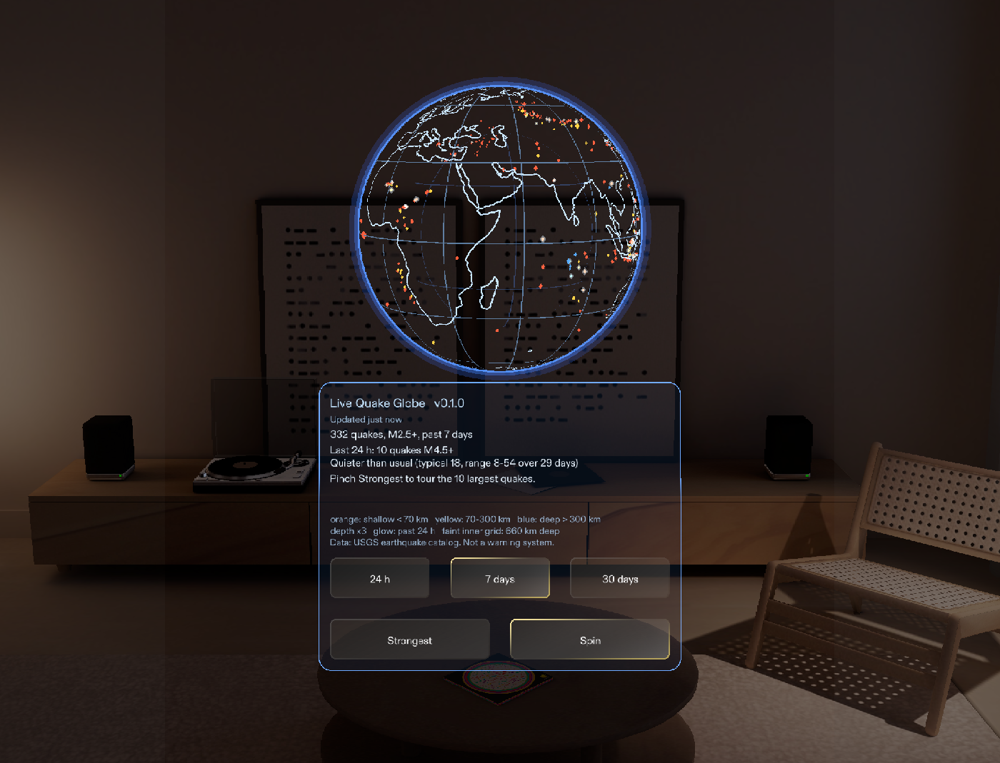
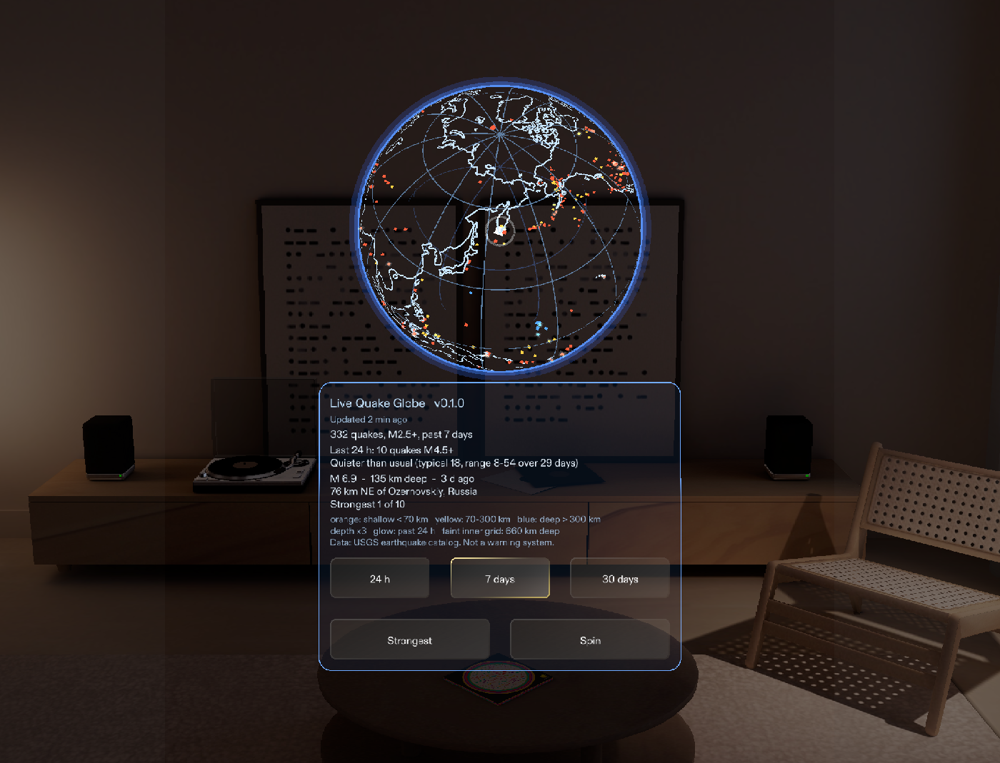
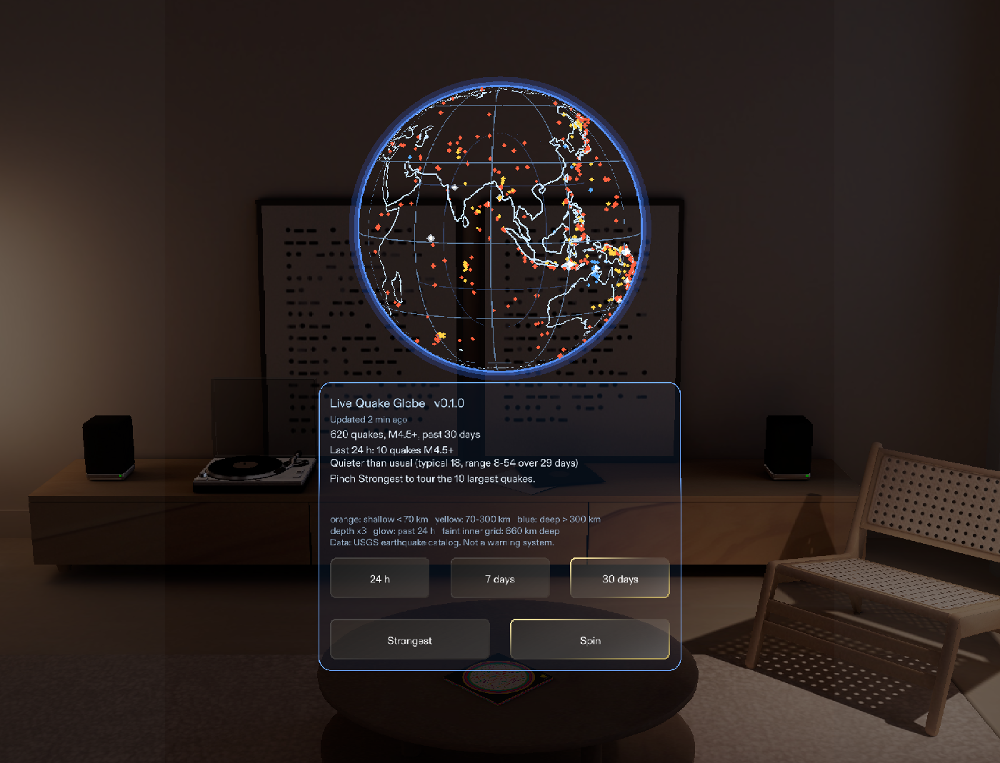
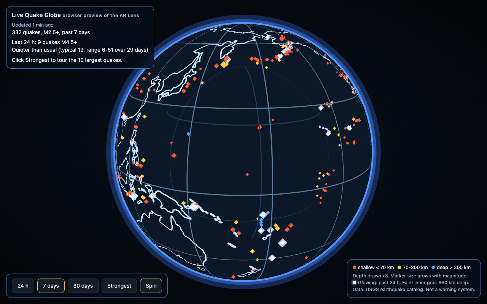
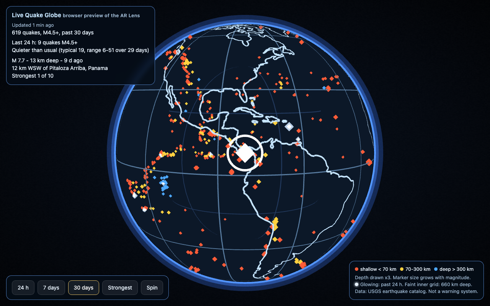
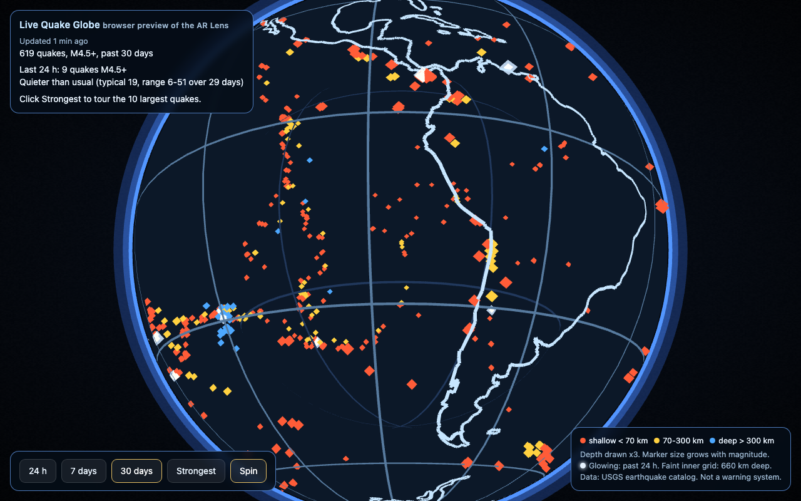

# Live Quake Globe

A live globe of the world's earthquakes for Snap Spectacles. Put it in front of you, walk around
it, and see quakes **inside** the Earth at their real depth, where they trace plates sinking into
the mantle. Data comes from the USGS real-time catalog and refreshes every five minutes.

**Running in the Lens Studio Preview (SPECS 27, live USGS data):**

| Seven days, idle spin | After pinching **Strongest** | After pinching **30 days** |
|---|---|---|
|  |  |  |

**Browser preview** (same core code, larger view):



| Strongest event of the month, turned toward you and ringed at its epicentre | Tonga at the edge of the globe: deep (blue) quakes sit well inside the Earth |
|---|---|
|  |  |

*The browser adds a dark far hemisphere so the globe reads as a volume on a monitor. Everything
else is the geometry the Lens draws.*

## What it does

- **Every quake at its real location and depth.** Depth is drawn three times deeper than true
  scale so slabs are visible on a 24 cm globe; the legend always says so.
- **Three windows:** 24 hours (M2.5+), 7 days (M2.5+), 30 days (M4.5+).
- **Strongest:** tours the ten largest events in the window. The globe turns the event toward
  you and shows magnitude, depth, time and place, then holds still so you can walk around it.
- **Is today normal?** Compares the last 24 hours of M4.5+ quakes with the previous 29 days,
  using plain counts and percentiles. No forecasting.
- **Honest about its data:** shows how old the picture is, says when it is offline, stale, or
  the device clock looks wrong, never drops records silently, keeps the last good data when a
  refresh fails, and starts from a saved copy when there is no connection.
- **Made for a see-through display.** Everything is light on dark, because dark pixels are
  transparent on the glasses. A soft atmosphere traces the globe's outline and stays on it as you
  walk closer. The newest quakes pulse, the selected one gets a ring at its epicentre, and a faint
  inner grid marks 660 km, where the deepest quakes stop. Panel and buttons are Snap's free
  Spectacles UI Kit ([free UI resources](docs/FREE_UI_RESOURCES.md)).

Not a warning system: a Lens only runs while it is open.

## How it is built

```
core/            platform-independent TypeScript, no dependencies, unit-tested in Node
  usgs.ts        feed parser and validator (counts every rejected record by reason)
  model.ts       app state: views, tour, refresh timing and backoff, status text
  activity.ts    "is today normal?" statistics
  freshness.ts   data age, staleness, clock sanity, retry backoff
  geo.ts         lat/lon/depth to 3D, rotations (quaternions), atmosphere scale
  lines.ts       coastline and grid geometry, as lines or as flat ribbons
  markers.ts     quake markers (one mesh per depth class), glows, highlight, epicentre ring
  shapes.ts      octahedron, depth stem, rings
  occluder.ts    line radius; dark far hemisphere for the browser preview
  style.ts       colours, glow pulses, marker size
  config.ts      every tunable, shared by Lens and preview
data/            Natural Earth coastlines (public domain), generated
lens/            complete Lens Studio project (SPECS 27, Interaction Kit, UI Kit);
                 scripts in lens/Assets/QuakeGlobe
web-preview/     three.js preview driven by the same core
tests/           69 tests, including runs against real USGS snapshots
tools/           build, local server, coastline converter, Lens type-check
```

The Lens and the preview are thin adapters. They fetch bytes, hand them to `GlobeModel`, and
draw what it returns. Everything that decides what is shown lives in `core/` and is tested.
`npm run build` copies the core into `lens/Assets/QuakeGlobe/` and a type-stripped copy into
`web-preview/js/`, so the two targets cannot drift apart.

A globe with no solid surface has a catch: coastlines on the far side show through as mirror-image
continents. Coastlines and grid are flat ribbons facing outward, and the script pins every material
to back-face culling, so the GPU drops the far half of every line and the Earth's interior stays
open. The browser preview draws the same ribbons with the same culling. It only adds a dark far
hemisphere (`core/occluder.ts`) so the globe has a visible volume on a monitor.

Design decisions and their reasons: [docs/DESIGN.md](docs/DESIGN.md).

## Verification

| Check | How |
|---|---|
| Core logic, including real USGS snapshots | `npm test` (69 tests) |
| Rendering and orientation | browser preview; probes confirm a selected event lands at screen centre with east to the right and north up, and that the innermost atmosphere ring sits just outside the globe's outline |
| Lens scripts against the real Lens Studio API | strict TypeScript check against the official declarations for Lens Studio 5.12, 5.19 and 5.24 with Interaction Kit 0.17.2 / 0.18.0 and UI Kit 0.1.5 / 2.0.0: `node tools/typecheck/check-lens.mjs --dts <studio.d.ts> --sik <SIK root> --uikit <UI Kit root>` |
| Running in Lens Studio | Lens Studio 5.24.1, SPECS 27 Preview, driven through Lens Studio's built-in MCP server: compiles, loads live USGS data, zero runtime errors or warnings. Simulated hand pinches on **Strongest**, **30 days** and **24 h** produce the expected globe turn, highlight, epicentre ring, detail text, legend and window switch. The atmosphere scale read back from the running Lens matches the formula at 100 cm and, after a simulated drag, at 50 cm |
| Runtime behaviour on hardware | independent review against Snap's samples and design guidelines; findings fixed. **Not yet run on a device.** |

## Run the tests and the preview

Requires Node 23.6 or newer (TypeScript runs natively; there are no packages to install).

```bash
npm test          # 69 tests
npm run preview   # builds, then serves http://localhost:8765/web-preview/
```

Preview options: `?fixture` uses the bundled USGS snapshots (offline, deterministic),
`?view=day|week|month`, `?select=1` preselects the strongest event, `?static` stops the spin and
the pulsing, `?focus=lat,lon` turns a place toward you, `?debug` exposes the orientation probes.

## Open it in Lens Studio

`lens/` is a complete Lens Studio project: open `lens/QuakeGlobe.esproj` in Lens Studio 5.22 or
later (SPECS 27) and press play in the Preview. For Spectacles (2024), which needs Lens Studio
5.15, the scripts are compatible but the project file is newer; create a project from the
Spectacles Base Template and copy `lens/Assets/QuakeGlobe` into it. Step by step:
[docs/SETUP_LENS_STUDIO.md](docs/SETUP_LENS_STUDIO.md).

## Data

- Earthquakes: USGS real-time GeoJSON feeds. Credit: U.S. Geological Survey. Public domain.
- Coastlines and labels: Natural Earth 1:110m and 1:50m. Public domain.
- Plate boundaries: PB2002 (Bird 2003), GeoJSON by Hugo Ahlenius, Nordpil and Peter Bird, under
  the Open Data Commons Attribution License 1.0.

Details and links: [docs/DATA_SOURCES.md](docs/DATA_SOURCES.md).

## License

Apache-2.0. See [LICENSE](LICENSE); the data credits are in [NOTICE](NOTICE). The Snap packages in
`lens/Packages` stay under Snap's own terms.
